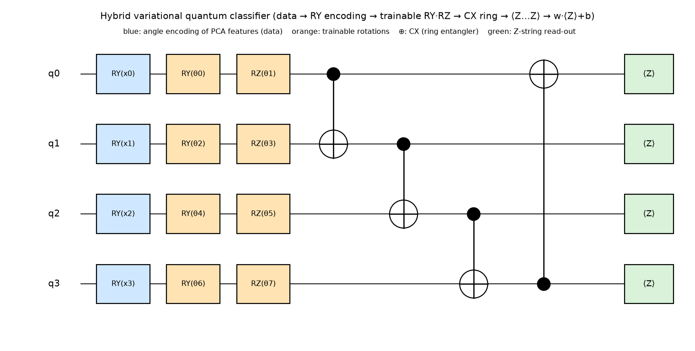

# VQC architecture (PS-Q1, selected on validation data only)

## Model
Input: 30 ECG window statistics → `StandardScaler` → `PCA(4)` → robust min-max map to angles `x ∈ [0, π]⁴` (all fitted on `ecg_train.csv` only).

Circuit `U(x, θ)` on 4 qubits, starting from |0000⟩:

1. **Angle encoding:** `RY(x_q)` on qubit q (component q → qubit q).
2. **Trainable layer:** `RY(θ_2q) · RZ(θ_2q+1)` on every qubit (8 parameters).
3. **Entangler:** ring of CX gates (0→1, 1→2, 2→3, 3→0), 4 two-qubit gates.
4. **Read-out:** parity observable `O = Z⊗Z⊗Z⊗Z`, `f(x, θ) = ⟨0|U† O U|0⟩ ∈ [−1, 1]`.

Hybrid decision head (2 classical parameters): `logit = w·f(x, θ) + b`, `p(abnormal | x) = σ(logit)`, predicted label = `[logit > 0]`.
Loss: class-weighted binary cross-entropy `L = −mean[ s_y ( y log p + (1−y) log(1−p) ) ]`, `s_1 = N_normal/N_abnormal`.
Optimiser: Adam (lr 0.08, batch 500, 20 epochs); exact parameter-shift gradients `∂f/∂θ_k = ½[f(θ_k+π/2) − f(θ_k−π/2)]`; seeds 0, 1, 2, best validation seed kept.

Resources: 4 qubits, logical depth 7, 4 CX, 12 single-qubit gates, 8 circuit parameters + 2 classical.

## Why this design
* Selected from a pre-declared grid (3–4 qubits × 1–2 layers × PCA/ANOVA × read-out) on validation macro-F1; ties (within 0.0015) broken by fewest CX, because each CX costs 5 % depolarisation in the organiser noise model. `results/model_selection.csv`, `results/ablation.csv`.
* Ablation facts (validation, 3 seeds): without any CX 0.9970 vs 1.0000 with the ring; chain instead of ring 0.9404; 5 qubits 0.9404 (more qubits is worse on this budget); read-out on qubit 0 only 0.9695. Deeper (2-layer) variants are no better and lose more under noise (dev-noisy 0.9778).
* Honest limit: the data is almost linearly separable (7 of 30 single features separate the classes perfectly on train), so every classical model also scores 1.000; the VQC shows no advantage, only a small, noise-robust circuit that matches the classical baseline.

## Reconciling the master prompt with the v3 kit (kit v3 is the latest authoritative document)
| Master prompt says | Official kit v3 says | Followed |
|---|---|---|
| Processors A/B/C on hardware, Processor C design | No hardware. Noisy **simulation** with `QFF2026-v2`; common **Task A** (Bell fidelity) and **Task B** (design **Processor D**, QFT-3 benchmark) | Kit v3 |
| MIT-BIH download, 4–8 features, 200–500 samples | Organiser data `data/q1` (6000/1500/1500, 30 features, fixed split) | Kit v3; 4 PCA components |
| Primary metric abnormal recall | Ranking metric macro-F1; baseline = logistic regression (1.000) | Kit v3; recall/precision/F1/accuracy all reported |
| Test accuracy/F1 | Test labels are hidden | Test copy has predictions; scores on train/validation |
| `solution.ipynb` etc. | Required names: `solution.ipynb`, `processor_d_config.json`, `predictions_q1.csv`, `results.md`, `README.md` | Kit v3 names at repo root |

## Status (what is verified vs pending)
| Item | Status |
|---|---|
| Simulator unit test, sweeps, training, ideal metrics, baselines, `predictions_q1.csv` (validator OK), test copy, diagram | **Run here, real outputs** |
| Task A, Task B (`processor_d_config.json`), noisy runs, mitigation, `results.md`, `pip_freeze.txt` | **PENDING**: need Qiskit/Aer (not installable in the build sandbox); produced by executing `solution.ipynb` |
